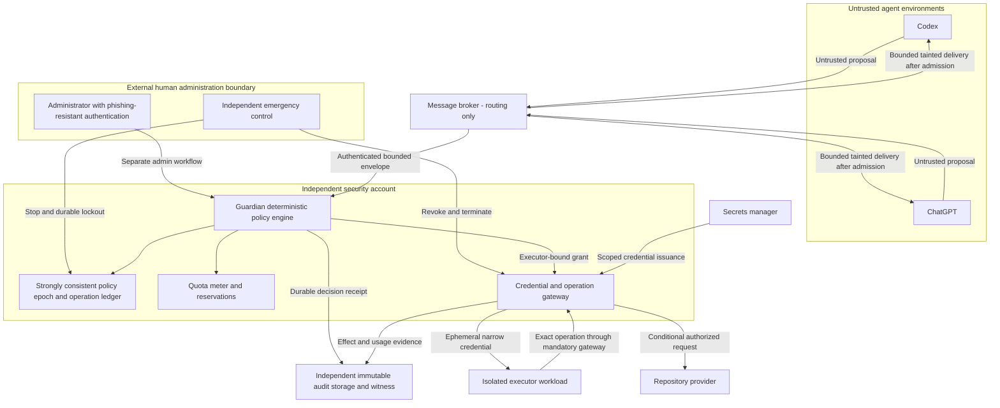

# G01 independent Guardian architecture

Status: DESIGN_COMPLETE_PENDING_IMPLEMENTATION. All controls below are proposed. Baseline evidence and C01–C10/T01–T16 traceability live in [threat model](G01-threat-model.md); contract in [policy](G01-policy-contract.md); evidence requirements in [tests](G01-adversarial-test-plan.md); blockers in [risks](G01-open-risks.md).

## Decision

Deploy Guardian in a separately administered security account/host outside Nexus and outside all agent/executor environments. Use a deterministic policy engine with no model calls, prompt interpretation, repository-supplied executable policies, or dynamic agent-selected plugins. Guardian is an additional mandatory security veto. Nexus can retain its NX1 preview/application role but cannot override Guardian; Guardian grants alone do not bypass Nexus review. Other NX1 consumers provide their own review/application adapter.

Propose reusable `@nx1/guardian-contract` (schemas, canonicalization, client data types and fixtures) and separately deployed `nx1-guardian-service` (policy evaluation, ledger and gateway). These names do not exist as delivered packages. Follow inspected ESM TypeScript/dist declarations/sideEffects conventions, with minimal dependencies and pnpm frozen-lockfile builds. Clients contain no policy signing key, secrets-manager authority or administrative transport. A malicious client may ignore validation; the service validates independently. Build/release administration is external, with digest-pinned artifacts and no automatic runtime loading from an agent-modified repository. Select supported runtime/library versions at G02 using current official support data; baseline Node range is evidence, not a future support guarantee.

## Architecture and trust boundaries

Arrows describe allowable interfaces, not completed integrations. Admission is required for agent-to-agent routing in a future user-authorized session; G01 performs no autonomous agent communication. Executor credentials authenticate a narrow gateway session. Where a provider supports sufficiently narrow direct credentials, direct execution remains disabled until its scope and revocation semantics pass A09/A11/A15.

| Boundary | Trusted responsibility | Inputs treated as untrusted | Enforcement/ownership |
| --- | --- | --- | --- |
| Human administration | Approve signed policies, reviews and recovery | Displayed agent text; repository policy proposals | Separate origin, audience, credentials and external identity provider; hardware-backed authentication; dual control for policy activation/unlock |
| Guardian | C01/C02/C03 decisions | All messages, IDs, scopes and claimed approvals | Separate account; fixed adapters; no agent IAM or admin route access |
| Broker | Bounded delivery only | Origin/payload/destination claims | Cannot issue grants; authenticated peers; destination bound; queue and rate caps |
| Agents | Produce proposals and consume tainted evidence | Each other and all retrieved content | No production secrets, GitHub writes, deployment authority or host shell; no alternate credentials/tool endpoints |
| Executor | Perform one admitted workload | Repository, build scripts, tools, patches | Per-job sandbox; supervisor controlled outside workload; grant-bound gateway identity |
| Repository provider | Current identity/head and conditional effects | Repository contents; uncertain responses | Stable provider repository ID; exact ref/head checks; gateway token; provider receipts |
| Secrets manager | Issue/revoke scoped credentials | Requested resource selectors | Gateway workload identity only; no agents; minimal TTL and independent kill path |
| Quota meter | C07 accounting and admission reservations | Provider-reported usage and agent MET | Trusted dispatch counters; atomic aggregate ledger; external caps |
| Audit storage/witness | C08 durable records and integrity checks | Executor claims and event content | Separate administration; append-only identity, retention lock, external checkpoints |

## Execution sequence

1. Authenticate workload identity at transport and signed envelope; enforce size/rate limits before expensive parsing. Reject agent claims of admin identity. Validate strict Guardian metadata and NX1 payload; preserve Core unknown-field behavior as data.
2. Resolve project/repository/ref against external administrative registry, never payload text. Construct an exact typed operation from the signed intent. Unknown operation mappings deny. Verify externally authenticated human review for selected PROP events; destructive DEL always needs explicit confirmation bound to exact digest/current revision.
3. Evaluate active policy and lockout epoch. Atomically consume replay identity, reserve aggregate budgets, allocate execution ID and commit admission/decision outbox in the trusted ledger. Deliver audit record and require durable receipt before dispatch. Denied traffic is rate-limited and boundedly audited too.
4. Create a fresh isolated workload with a pinned image and immutable base checkout. Executor receives only an ephemeral gateway credential bound to its attested workload/session, exact operation digest, scope, budget reservation and policy/lockout epoch. No model sees that credential.
5. Gateway rechecks lease, epoch, budget and repository preconditions at each effect boundary. Network egress permits only exact required gateway endpoints. Execute one fixed adapter action; no command from prose. Arbitrary code builds, when separately approved, run in a credential-free sub-sandbox and yield data for a trusted adapter to validate.
6. Persist provider dispatch identity before sending; settle observed resource usage, effect receipt and result. Never auto-retry an ambiguous non-idempotent effect. Mark UNKNOWN and retain reservation/lock until provider reconciliation or external recovery. Tainted result text cannot alter policy or authorize follow-up work.

## Isolation and credentials (C05)

Use a fresh sandbox VM or microVM boundary for adversarial code; containers alone are not the selected security boundary. Inside it use non-root processes, no capabilities/privileged mode, read-only root filesystem, namespace separation, syscall filtering and CPU/memory/PID/disk/output ceilings. No host mounts, container socket, shared agent home, SSH agent, cloud credentials, policy files or audit store. Workspace is per-execution and ephemeral; approved paths are validated after canonical resolution, including symlinks and traversal. Downloads, dependency lifecycle scripts and executable repository hooks are code and require a separate approved sandbox capability. No runtime package installation by default.

Host/network-level default-deny egress must resist raw sockets, IPv4/IPv6, custom DNS, redirect/rebinding, QUIC, proxies, metadata endpoints and private ranges. Use mandatory gateway routes, fixed DNS policy and destination/method/path/body constraints; a browser proxy setting alone cannot prevent process bypass. Bound result sizes and sanitize review rendering. Resource controls are set by an external supervisor the workload cannot alter. Destroy the sandbox after completion; quarantine artifacts after compromise. [NIST SP 800-190](https://csrc.nist.gov/pubs/sp/800/190/final) is container security background, not certification of this design.

Only the isolated executor receives an operation credential; issuer/gateway infrastructure necessarily retains credential issuance authority outside agent/workload reach. Prefer opaque, sender-bound gateway credentials lasting at most 60 seconds and renewable only against live authority/epoch. Scope is further restricted by actual admitted operation, not just the provider token's coarse rights. Provider write/deployment authority lives behind fixed gateway adapters. G02 has no production write/deployment adapter. A credential stolen by a compromised executor can still be used inside its narrow scope; no claim of eliminating that risk.

## Emergency and outages (C06/C09)

The independently hosted kill control has ledger/gateway/secrets/host revocation interfaces and no dependency on broker, agents or Nexus. Stop request requires authenticated external operator identity; operator may stop immediately without dual approval. Its separately durable kill registry persists LOCKED plus increased lockout epoch before acknowledging success, then propagates fencing into the operation ledger. Admission and gateway effects require both registries to be reachable, current and unlocked; either lock wins, and loss of either registry denies. This permits durable stop when the operation ledger is unavailable. If the kill registry cannot persist, issue best-effort revoke/terminate but report STOP_UNCONFIRMED, never durable success. Block admission and delivery, fence queued grants, revoke gateway credentials, close sessions/egress, cancel provider calls and terminate workloads where supported. Acknowledgement distinguishes durable lockout from unconfirmed cancellation/revocation. Recovery must reconcile both registries against external witnessed epochs before either can unlock.

In-flight effects: before dispatch, deny; after dispatch, attempt cancellation without assuming success; already committed Git/deployment/payment/exfiltration cannot be undone by revocation. Record EFFECT_UNKNOWN until external readback verifies outcome; compensations are new externally authorized operations, never automatic agent rollback. Measure kill propagation and provider token revocation latency in G02; lease expiry bounds only new gateway admission, not provider completion or already accepted requests.

Service, policy registry, ledger, quota or audit unavailability denies new work and lease renewal. Stale replicas cannot issue grants. Workers fail closed on lease expiry; no offline token authorizes gateway effects. A partitioned compromised process may continue local computation until external termination/host TTL; this limitation is explicit. Durable LOCKED survives restart and backup recovery. Missing epoch or rollback-detected restore defaults to LOCKED. Resume requires separate authenticated external dual approval, incident reconciliation, verified checkpoint/epoch, fresh policy and fresh grants; queued work is not automatically resumed.

## Audit and incident recovery (C08)

Store decision ID, verified principal, administrative actor when applicable, execution/correlation IDs, typed intent and payload digests, repository/ref/head, policy digest/version, lockout epoch, denial reason, reservations/usage uncertainty, dispatch/provider receipts, kill/cancellation outcomes and administrative changes. Never log secret values, tokens or full sensitive prompt/tool bodies by default. Encrypted restricted incident blobs may hold explicitly approved content separately.

Ledger transactional outbox orders committed events; independent writer appends sequence-numbered canonical records with previous-record digest. Audit storage uses retention-locked objects and distinct append/read/admin principals. Sign periodic checkpoint roots using external keys and witness them in a separately controlled location; verify sequence gaps, truncation, altered bytes, missing segments and stale checkpoints on a scheduled external verifier. Hashes alone do not stop deletion or prove completeness. Audit outage blocks dispatch; emergency kill still operates and records a durable local trusted event for later append. Bounded denial-log buffers must trigger closed ingress on saturation; suppression counters preserve flood evidence.

Proposed retention, requiring external privacy/operational approval: decisions, usage and checkpoints 180 days; admin/emergency events 365 days; optional incident content 30 days or approved hold. Encrypt, minimize identities in analyst views, enforce role-based access and record reads. On retention expiry delete only through external storage workflow and checkpoint the retention boundary. Recover by verifying witnessed checkpoints, restoring ledger/epoch without rollback, reconciling UNKNOWN provider effects and reservations, rotating keys/credentials, rebuilding trusted hosts and requiring external unlock. Availability and legal retention obligations remain external dependencies.
