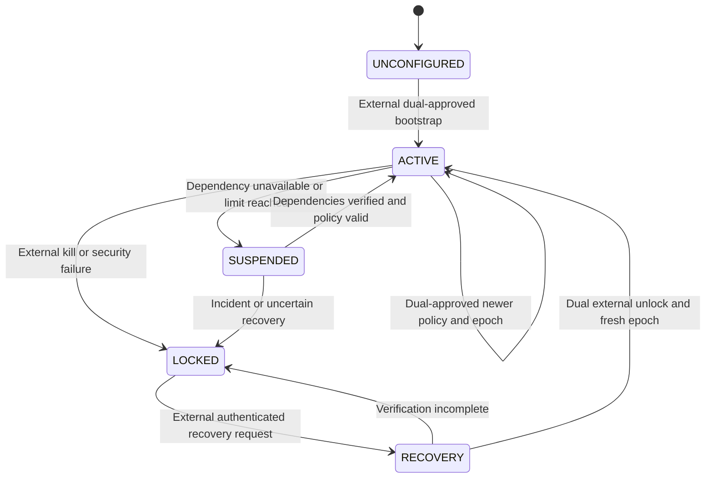

# G01 proposed policy and message contract

Status: DESIGN_COMPLETE_PENDING_IMPLEMENTATION. This is a design contract, not deployed policy or a parser implementation. See [baseline/threats](G01-threat-model.md), [architecture](G01-architecture.md), [tests](G01-adversarial-test-plan.md) and [G02 gates](G01-open-risks.md).

## Compatibility and authority (C01–C03)

Core NX1 1.3 remains unchanged: PROP/EV are proposals, preview is required, DEL needs explicit human confirmation, revision conflicts deny, omitted visibility stays internal, unknown data is preserved/ignored by Core. Neither ACK text nor an ART/MET record is proof of approval, usage or execution. Guardian requires explicit VER:1.3 for live operation requests. Core still accepts stored legacy 1.1; historical records can be displayed but cannot be replayed as live grants.

A strict outer JSON envelope named `nx1-guardian-envelope/1` carries an unchanged NX1 string. Its independent version is not a new NX1 version. Reject unknown or duplicate outer keys and duplicate security fields before authority interpretation. Unknown NX1 blocks remain tainted display data; they never become policy fields. Reject ambiguous live operation payloads (including duplicate VER/PROP or repeated authoritative event keys) at the Guardian mapping boundary without changing Core parsing. A valid Core envelope requesting a forbidden effect is denied server-side.

Policies are closed declarative records with policy ID, monotonically increasing version/activation epoch, canonical digest, validity interval, project/repository registry bindings, allowed actor roles and typed operations, exact scopes, human review requirements, budgets, adapter/image digests, retention and fixed cryptographic profile. Unknown policy fields, executable expressions and incomplete limits reject. Policy content is authenticated and integrity-protected by external signatures; activation references two distinct external administrative approvals and an expected current epoch. Activation is transactional and audited; agents and broker cannot publish, sign, activate or roll back it. Bootstrap trust roots are installed through separate administration. Older version/digest, downgrade, missing trust roots or unavailable currentness means deny. A proposed policy in this repository never becomes active automatically.

## Strict envelope fields

Every field below is required; nullable fields are allowed only where the chosen closed message kind specifies them. IDs use bounded ASCII, timestamps UTC epoch milliseconds as safe integers, SHA-256 digests fixed lowercase hex, money integer micro-units plus currency, never floating-point cost.

| Field | Meaning and validation |
| --- | --- |
| `schema`, `nx1Version`, `kind` | Exact schema / 1.3; kind is proposal, delivery, decision or result; admin operations use a separate API/audience |
| `messageId`, `nonce` | Unique message ID and at least 128 random nonce bits; durable replay namespace includes verified sender and audience |
| `correlationId`, `parentMessageId` | Registered session chain; bounded depth; null parent only for externally initiated root |
| `executionId` | Externally allocated execution/session ID; never trust a caller-created ID as authority |
| `sender`, `audience` | Identity-provider subject and exact destination; signature/transport identity must match sender; never derived from NX1 text |
| `issuedAt`, `expiresAt` | TTL <=60 seconds, <=5 seconds permitted skew; trusted clock plus monotonic execution deadlines; clock uncertainty denies |
| `projectId`, `repositoryId`, `branch`, `expectedHead` | Exact registered project and provider-stable repository ID, canonical ref and full provider commit ID; readback at effect boundary |
| `operation`, `scope` | Closed discriminated intent with exact event selection, paths and operation-specific parameters; fixed mapping, not prose or shell strings |
| `policyId`, `policyVersion`, `policyDigest`, `lockoutEpoch` | Must match current external authority; agent-selected values are assertions to verify |
| `budgetReservationId` | Trusted ledger allocation ID; never a self-granted amount; includes aggregate parent-session binding |
| `payload`, `payloadDigest`, `intentDigest` | Strict UTF-8 NX1 string, hash of exact UTF-8 bytes and hash of canonical typed intent; no prose normalization after hashing |
| `auth` | Closed `{keyId, signature}` using administratively pinned Ed25519 keys; unpadded base64url signature, no caller-selected algorithm; service-issued signatures cannot be made by agents |

Sender keys reside in managed identity ingress infrastructure; agents may request signatures only for their own proposal/delivery-request scope, never admin/decision scope. A valid signature proves origin, not authorization or truth. Use mutually authenticated transport/service identity as an additional boundary. Broker cannot re-sign an agent as an administrator. Deny credential audience substitution and sender/destination mismatches. Key enrollment/rotation/revocation uses external administration; unknown/revoked key denies. Cryptographic compliance or unavailable key support is a G02 blocker, not grounds for algorithm fallback.

Proposed fixed bounds: total envelope <=65,536 UTF-8 bytes, payload <=32,768 bytes, JSON depth <=8, <=64 NX1 blocks, <=16 events, <=32 scope paths, IDs <=128 ASCII bytes, paths <=512 bytes. Stream under a five-second ingress deadline; reject compression and malformed UTF-8, duplicate JSON keys, invalid Unicode and unsafe numbers before canonicalization. Canonical signing bytes are `NX1-GUARDIAN-ENVELOPE/1` plus newline plus UTF-8 JCS of all outer fields except `auth`; keyId is resolved by authenticated ingress identity and verified against a fixed key registry. Intent and policy digests use separately domain-tagged JCS. Exact payload bytes are included, not a reserialized Core parse. [RFC 8785](https://www.rfc-editor.org/rfc/rfc8785) defines JCS; a hand-written key sorter or JSON.stringify alone is not asserted to implement it.

## Authorization and permission matrix

Admission is the conjunction of verified identity, live policy/epoch, allowed typed intent/scope, exact project/repository/ref/head, unexpired grant, durable replay claim, human approval where required, reserved aggregate resources and durable audit receipt. Schema validity alone never satisfies it. Recheck at use and after any external delay; trusted snapshots/lease IDs are not agent assertions.

| Principal | Submit proposals / receive tainted messages | Review/activate policy or unlock | Protected effects | Credentials / budgets / audit |
| --- | --- | --- | --- | --- |
| ChatGPT or Codex | Only own authenticated bounded session; no automatic follow-up authority | Never | Never directly | No production secrets, budget changes or audit write/delete |
| Broker | Route admitted bounded messages | Never | Never | No grants, policy keys or resource increases |
| External user/reviewer | Initiate session and approve exact proposed events via authenticated UI | Only assigned external admin role; dual control on activation/unlock | Request within external policy; review cannot override hard deny | Read permitted audit views; changes only separate admin workflow |
| Guardian engine | Issue decisions from validated evidence | Validate external activation; cannot invent approval | Authorize fixed adapter intent | Atomic reservations and outbox; no log deletion |
| Executor workload | Return bounded tainted result | Never | Only admitted fixed action through gateway | Ephemeral scoped session credential; cannot raise cap/alter lease |
| Credential/operation gateway | No agent planning | Never | Exact approved provider operation with current epoch/preconditions | Issue/revoke scoped executor credential; provider secret held externally |
| Quota meter | Trusted observed usage only | Never | Stop at resource boundary | Reserve/settle within externally approved cap; no self-increase |
| Audit writer/verifier | No execution authority | Never | Never | Append / read-verify respectively; no deletion or policy modification |

G02 candidate operation allowlist: session.deliver, repository.read_snapshot, proposal.preview, sandbox.check and artifact.read, all non-production. `sandbox.check` executes only an externally approved fixed job profile in a credential-free VM. Repository write, merge, deploy, arbitrary shell, policy.update, quota.increase, unlock and secrets.read remain denied. Future write adapters require a new external design/approval gate, CAS/precondition validation, exact patch/tree digest and path limits. Human DEL confirmation does not itself enable a disabled destructive adapter.

## State machines and replay (C04/C06/C09)

UNCONFIGURED/LOCKED/RECOVERY/SUSPENDED admit no effects. Transient SUSPENDED may recover automatically only for verified dependency recovery, never incident lockout, budget exhaustion or an expired policy. Exhausted session remains terminal; a new budget/session requires external approval. Security failures include integrity/epoch rollback and credential escape; not every denied proposal globally kills service (avoid attacker-triggered universal lockout). Authenticated emergency lockout is separate from denial.

Operation ledger states: RECEIVED -> DENIED or RESERVED -> AUDIT_READY -> DISPATCHING -> SUCCEEDED / KNOWN_FAILED / CANCELLED / EFFECT_UNKNOWN. Emergency/expiry may cancel before dispatch. After dispatch cancellation is only confirmed with supervisor/provider evidence; otherwise EFFECT_UNKNOWN. Terminal result never issues another operation grant. Stable logical operation ID and intent digest survive message nonce renewal. Persist nonce consumption and reservation atomically; duplicate same intent returns stored status without dispatch, conflicting intent returns REPLAY_CONFLICT. Retain nonce claims beyond expiry+skew and operation tombstones throughout retention; expired messages remain rejected even after nonce pruning. A new ID is still a new charged operation; aggregate caps prevent ID churn bypass. Unknown effects are never automatically redispatched or refunded.

## Budgets (C07)

All caps are externally approved absolute values per execution, parent collaboration session, project and provider account; agent requests can only reduce them. Admission reserves the worst-case bounded usage atomically across applicable dimensions. Zero/unknown/missing caps deny; ledger overflow denies. Count attempts and retries, include nested tools/build children, charge admitted delivery cycles and enforce a maximum parent-chain depth. Acquire concurrency slot before spawn and hold it through termination/reconciliation; a hung job cannot free a slot by claiming completion.

| Dimension | Trusted enforcement | Uncertainty handling |
| --- | --- | --- |
| Iterations/deliveries/tool calls | Broker/gateway counters, including denied-rate caps and explicit retries | No counters accepted from agent MET |
| Duration/concurrency | Monotonic supervisor deadlines, process-tree kill, ledger leases and OS limits | Renewal failure stops; cancellation latency measured |
| Tokens | Gateway token estimator plus enforced provider output-token ceiling where supported; reserve input upper bound and output maximum | Provider-reported counts are telemetry; missing/delayed usage keeps reservation |
| Monetary spend | Integer price schedule/version bound to allowlisted model; pre-reserve conservative upper bound, retries and documented non-token fees; external account controls | Unknown price/fee bounds deny paid operation; settle only authoritative receipts; overrun locks account scope |
| Actual provider/model quota | Provider/account controls where their semantics are verified | No exact guarantee for an opaque ChatGPT/Codex shared five-hour window |

No numeric five-hour percentage cap was supplied for G01. This document neither invents a cap nor guarantees measured consumption. For future policies expressed as a percentage, require externally supplied reliable window denominator, usage feed and account scope; if absent, block exact-quota mode and use externally approved conservative absolute proxy limits plus provider-side controls. Proxies bound requests/time/output but cannot prove actual shared account quota. Out-of-band provider use must be disabled or accounted for by the external administrator. Missing telemetry never authorizes an automatic increase. Provider APIs, administrative spend controls and termination semantics must be verified in G02; no current capability is assumed.
