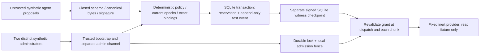
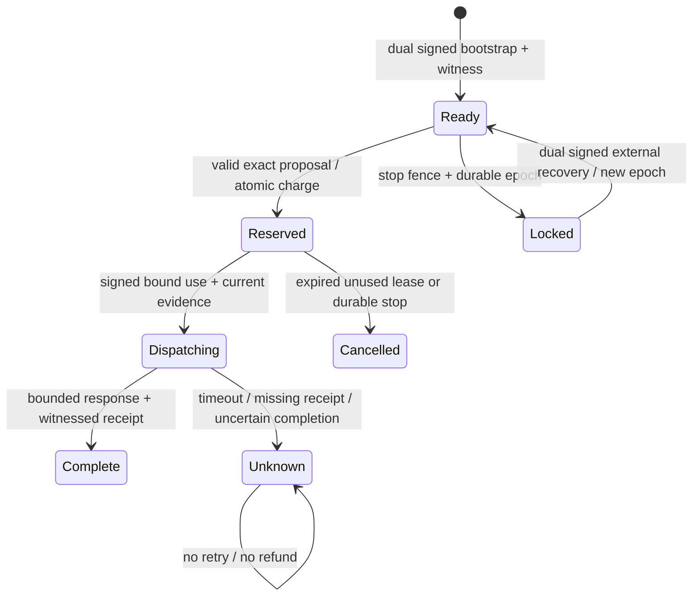

# Laboratory architecture and boundaries

| Boundary | Trusted responsibility | Agent capability |
|---|---|---|
| User-controlled administration | Supplies roots/initial policy; two distinct signed admin identities; no production workflow | None; prose or two agent signatures cannot approve |
| Guardian policy engine | Validates identity, policy digest/epoch, scope, lease, clock and evidence | Signed proposals and signed use of its exact recorded grant |
| Broker | No active broker in G02A-0; raw input can be arbitrarily malicious | Cannot issue or alter authority |
| Ledger/meter | BEGIN IMMEDIATE; global single outstanding reservation, aggregate per externally opened root session | No writes, refunds, cap increases or free child budgets |
| Executor/provider | Fixed inert read provider, no shell/network/cloud adapters | No real effects or secrets |
| Repository provider | GitHub used only for bootstrap read/clone; not wired into core | No fake grant can call GitHub |
| Secrets manager | Not present; synthetic signing only | No production credential route |
| Audit writer | Events appended inside ledger transaction; update/delete triggers | No audit administration API |
| Witness | Separate adapter/database/key, verifies sequence and digest | No checkpoint-signing capability |
| Host/infrastructure | Current trusted development host | Real independent custody/confinement NOT established |

No actor may use the proposal channel to activate/update policy, increase caps, enroll keys, bypass lockout or administer witness/storage. A constructor is a trusted laboratory composition boundary, not an agent administration endpoint. Initial policy needs two cryptographically distinct synthetic administrators. Restart does not overwrite persisted policy from constructor arguments. Trust-root revocation is tested through synthetic root configuration, not a live identity-management service.

SQLite reserves resources and appends a canonical audit event atomically. Events commit the complete synthetic state, including decisions/reasons, caller or administrative subject IDs, intent digests, resource reservations and emergency state. A separately signed witness checkpoint must acknowledge that exact sequence/hash before an admission can return ALLOW or a dispatch can proceed. Checkpoints are separate local transactions: crash/failure between ledger commit and checkpoint advancement causes permanent fail-closed evidence mismatch. Reserved resources remain charged. This deliberately sacrifices availability; there is no automatic checkpoint repair.

Append-only SQL triggers prevent ordinary fixture UPDATE/DELETE; dropping triggers or editing files is possible for the trusted host. Hash-chain recomputation plus the witness detects corruption/rollback when at least one honest witness remains. Local chaining is **not** immutable storage, independent infrastructure or proof against combined host/witness compromise.

The maximum audit sequence is 1,024, stored sessions 16, administrative command IDs 64, canonical object/array members 1,024, depth 8, request 65,536 ASCII bytes and untrusted text 32,768 bytes. There is no queue: concurrent effect reservations are denied. Audit capacity exhaustion denies further work; an emergency that cannot persist returns STOP_UNCONFIRMED. Denial floods can still deny service. Resource ceilings do not preempt blocking/malicious native code.

State machines:

Recovery terminalizes every prior session; fresh work needs a separately signed new root session. Unknown/dispatching effects continue to hold the global concurrency slot, including after recovery. There is no implemented administrative reconciliation of unknown external effects. This prevents privilege resurrection, automatic refund and blind retries.

STOP_DURABLE means witnessed lock state is persisted. FIX-01 permits STOP_ENFORCED only when cancellation/revocation are acknowledged by the fake provider, the local controller map is empty, and a witnessed transaction verifies the shared ledger is locked with no DISPATCHING or UNKNOWN operation in any session. A different worker's pending operation blocks confirmation; UNKNOWN keeps blocking after restart or recovery. Provider booleans never clear ledger uncertainty. No administrative reconciliation is implemented.

STOP_UNCONFIRMED means persistence/evidence failed. FIX-02 retains a private snapshot of the latest integrity-verified read or fully witnessed transition. If an early context read fails, only an authenticated STOP matching that snapshot's authority, policy, resource, subject, epoch and replay constraints may set the local fence and abort tracked waits. The snapshot must be no older than the 60-second laboratory session window. It cannot authorize open/recover, policy changes, durable lock confirmation or enforcement confirmation. Unknown, stale or foreign context is denied. A cross-worker epoch change during outage may not be known: cached authority supports only conservative local containment, not authoritative durable admission/recovery.

The first unacknowledged incident retains command digest, administrator IDs, failure stage and bounded reason code in memory. A healthy ledger/witness later receives LOCAL_STOP_UNCONFIRMED before resumed work is considered. Audit flushing never clears the fence. Failed audit advancement retains the committed record and fails closed on mismatch. Recovery requires a current dual-signed durable stop followed by a separately authenticated recovery; restoring reads alone cannot release the process fence. Both fence and pending incident can be lost on process exit before persistence, so restart durability cannot be claimed for this path.

FIX-02 also requires both cancellation/revocation responses to be exactly boolean true; truthy objects, strings, numbers, boxed booleans and promises remain STOP_DURABLE. Thrown responses are STOP_UNCONFIRMED. The synchronous fake-adapter contract does not await asynchronous cancellation. A remote worker may still complete an already attempted inert effect: each chunk/receipt rechecks the durable epoch, and the result becomes UNKNOWN with its charge retained. Thus STOP_DURABLE is not a promise that an in-flight effect was cancelled. STOP_ENFORCED is only a bounded lab statement, not proof of real cancellation or irreversible-side-effect rollback.

Dispatch acquires ownership only after its exact authenticated grant transitions RESERVED to a witnessed DISPATCHING state. Rejected or duplicate callers do not settle any operation or delete an owner's controller. Only the acquired dispatch can record uncertainty for its exact grant; cleanup compares controller identity. Missing witness acknowledgement retains the persisted intent without starting the effect. Already attempted/completed effects are distinguished by a synthetic observer; irreversible real effects are not exercised.
