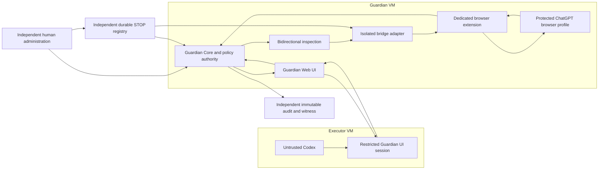

# Target architecture: inactive two-VM bridge

This is a target, not installed infrastructure. Codex cannot receive the Guardian profile, cookies, native messaging socket, browser debugger port or direct ChatGPT network route. Guardian UI access alone does not enforce those restrictions. External administration owns VM configuration, trust roots, policy promotion, release installation, secrets and recovery. Neither agent administers these resources.

Future component messages need a separately reviewed NX1 1.3-compatible extension profile: trusted actor/component identities, project/repository/branch/scope, request/conversation/parent/turn IDs, direction, sequence, nonce, exact original/transmission hashes, policy/emergency epochs, expiry and reserved budget. Explicit byte encodings bind Unicode data through hashes/encoded payload without weakening the existing ASCII control serialization. No such profile is activated by this iteration. Schema-valid data is never authorization.

Proposed lifecycle: proposed -> inspected -> approval-required/blocked -> authorized and reserved -> dispatch-intent witnessed -> sent -> response-streaming -> response-completion independently verified -> inspected-return -> released. Lost connection, auth expiration, selector drift, timeout, audit failure or ambiguous send/completion becomes UNKNOWN/quarantined. A stop freezes admission, fences workers, attempts verified cancellation/revocation and remains locked until independent recovery. Absence of a spinner/stop button is not sufficient completion evidence; a supported lifecycle source and correlation are mandatory.

No active extension, listener or browser dispatch path exists. The inert UI is a visual sketch. Future Codex capabilities must be exact read-only repository scope, approved development commands and Guardian UI origin; arbitrary desktop, unrestricted browser, credential, deployment, publication, policy and spend actions remain denied. Current development tools are not contained by this design and are therefore an activation blocker.
